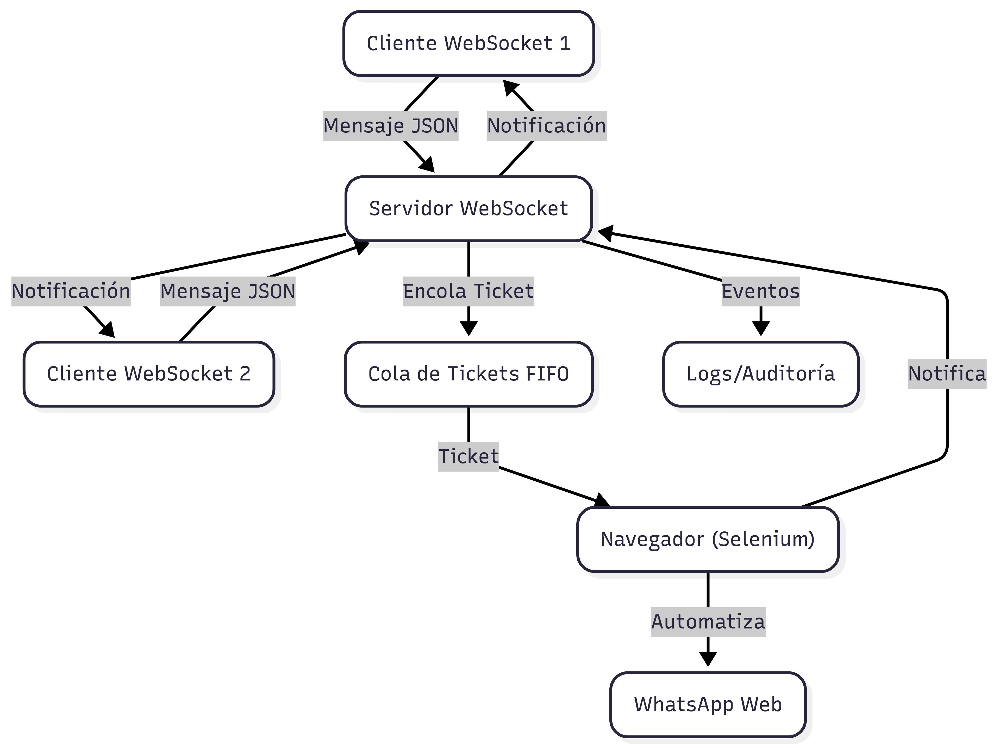
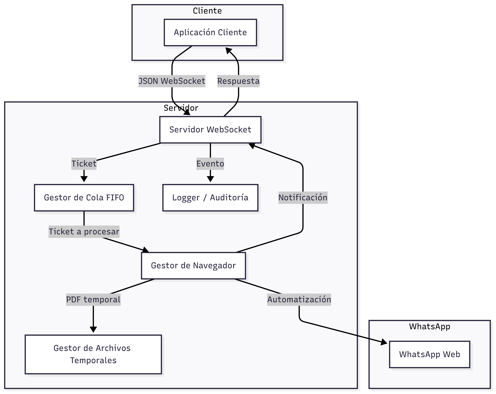
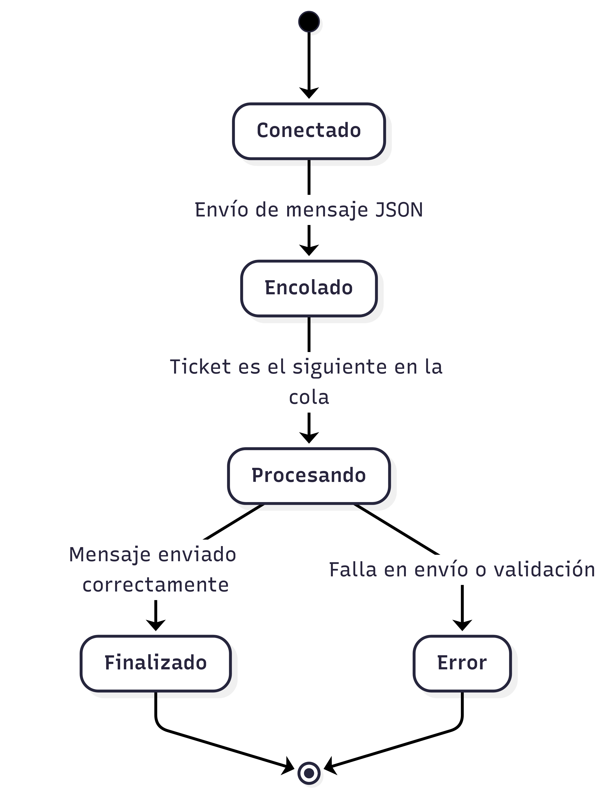
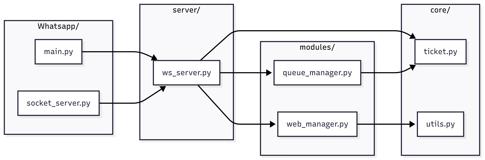
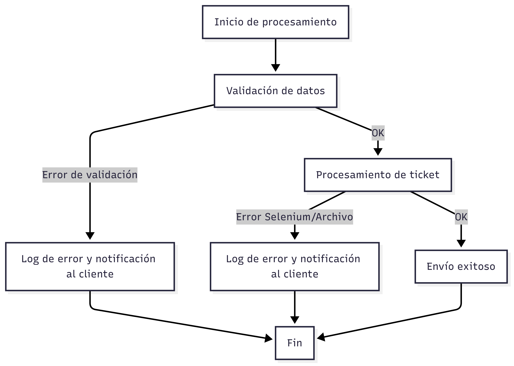
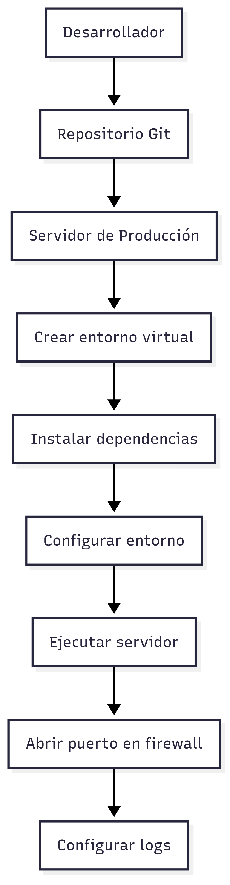

---

# 📚 Documentación Técnica Completa - WebSocket WhatsAppBot

> **Nota:** Para visualizar correctamente las imágenes en este documento:
> - Abre el archivo `doc.md` desde la carpeta `Whatsapp/docs/`.
> - Asegúrate de que la carpeta `img` esté dentro de `docs` y contenga todas las imágenes.
> - Usa un visor de Markdown compatible (por ejemplo: VSCode, Typora, Obsidian, MarkText, o el plugin de Markdown de PyCharm).
> - Si usas Windows, las rutas relativas como `img/Nombre de la imagen.png` funcionarán correctamente si abres el archivo desde la carpeta `docs`.

---

## Índice

1. [Introducción](#introduccion)
2. [Arquitectura General y Sectorización del Código](#arquitectura)
   1. [Estructura de Carpetas y Responsabilidades](#estructura)
   2. [Flujo General y Diagrama Visual](#flujo-visual)
3. [Conexión y Configuración](#conexion)
4. [Formato de Mensajes y Protocolo](#formato)
5. [Validaciones y Reglas de Negocio](#validaciones)
6. [Flujo de Estados y Notificaciones](#flujo)
7. [Ejemplos de Requests y Responses](#ejemplos)
8. [Casos de Prueba y QA](#pruebas)
9. [Recomendaciones para Clientes y Buenas Prácticas](#recomendaciones)
10. [Errores Comunes, Manejo y Troubleshooting](#errores)
    1. [Manejo de Errores y Logs](#manejo-errores)
    2. [Ejemplos de Logs y Respuestas](#ejemplos-logs)
11. [Notas de Seguridad y Privacidad](#seguridad)
12. [Soporte Multi-Navegador y Escalabilidad](#multi-navegador)
13. [Monitoreo, Logs y Auditoría](#monitoreo)
    1. [Buenas Prácticas de Auditoría](#auditoria)
14. [Despliegue y Operación en Producción](#despliegue)
    1. [Pasos Detallados de Despliegue](#pasos-despliegue)
    2. [Supervisión y Backups](#supervision)
15. [Preguntas Frecuentes (FAQ)](#faq)
16. [Contacto y Soporte](#contacto)

---

## 1. <a name="introduccion"></a>Introducción

El WebSocket WhatsAppBot es un microservicio que permite enviar mensajes y archivos PDF a través de WhatsApp Web de manera automatizada, gestionando una cola de tickets y notificando al cliente en cada etapa del proceso. Es ideal para integraciones, bots, notificaciones y sistemas de atención.

---

## 2. <a name="arquitectura"></a>Arquitectura General y Sectorización del Código

### 2.1. <a name="estructura"></a>Estructura de Carpetas y Responsabilidades

- **Whatsapp/** (raíz):
  - `main.py`, `socket_server.py`, `socket_client.py`: scripts principales para iniciar el servidor, cliente y pruebas locales.
  - `.gitignore`, `setup.cfg`, `.coverage`: archivos de configuración y control de versiones.
- **core/**: Lógica central del sistema.
  - `ticket.py`: definición y gestión de tickets.
  - `utils.py`: utilidades generales.
- **modules/**: Funcionalidades específicas y auxiliares.
  - `web_manager.py`: gestión de navegador y automatización con Selenium.
  - `queue_manager.py`: gestión de la cola FIFO de tickets.
  - `browser_profiles/`, `chrome_profiles/`: perfiles persistentes de navegador.
- **server/**: Implementación del servidor WebSocket y lógica de procesamiento.
  - `ws_server.py`: servidor WebSocket, gestión de conexiones, notificaciones y procesamiento de tickets.
- **tests/**: Pruebas unitarias y de integración.
  - `test_*.py`: pruebas para cada módulo principal.

#### Resumen de Responsabilidades

- **main.py / socket_server.py**: Arranque del servidor, gestión de conexiones y ciclo principal.
- **core/**: Lógica de negocio, controladores de sesión, utilidades generales.
- **modules/**: Validación, manejo de archivos, integración con Selenium y gestión de la cola.
- **server/**: Implementación de la cola de tickets, notificaciones y procesamiento de tickets.
- **tests/**: Pruebas automáticas para asegurar la calidad del sistema.

### 2.2. <a name="flujo-visual"></a>Flujo General y Diagrama Visual



---

## 2.3. Diagrama de Componentes de la Arquitectura



---

## 3. <a name="conexion"></a>Conexión y Configuración

### **Configuración del Servidor**

- **Host**: `0.0.0.0` (todas las interfaces)
- **Puerto**: `3060` (configurable)
- **Navegador**: `"chrome"`, `"firefox"` o `"edge"`
- **IP de acceso**: `192.168.2.90` (debe estar conectado a la VPN interna de la empresa para ser accesible)

**Ejemplo de inicialización:**
```python
server = WebSocketServer(host="0.0.0.0", port=3060)
await server.start()
```

### **Configuración del Cliente**

- **Host**: `192.168.2.90`
- **Puerto**: `3060`
- **Protocolo**: `ws://`
- **VPN**: El cliente debe estar conectado a la VPN interna de la empresa para acceder al servidor.

**Ejemplo de conexión:**
```
ws://192.168.2.90:3060
```

- Si el cliente está en otra red, asegúrate de tener VPN interna o reglas de firewall adecuadas.

---

## 4. <a name="formato"></a>Formato de Mensajes y Protocolo

### **Request (Cliente → Servidor):**

```json
{
  "id": "c1b2a3d4-5678-1234-9abc-abcdef123456",
  "metadata": {
    "phoneNumber": "3027032694",
    "message": "Hola, este es un mensaje de prueba.",
    "fileName": "prueba.pdf"
  },
  "PDF": {
    "data": [37, 80, 68, 70, ...] // (opcional) lista de bytes del PDF
  }
}
```

O bien, puedes enviar el PDF como base64:

```json
{
  "id": "b1e2c3d4-5678-4abc-9def-1234567890ab",
  "metadata": {
    "phoneNumber": "3027032694",
    "message": "Hola, este es un mensaje de prueba.",
    "fileName": "prueba.pdf"
  },
  "PDF": {
    "data": "JVBERi0xLjQKJeLjz9MKMSAwIG9iago8PC9UeXBlL0NhdGFsb2cvUGFnZXMgMiAwIFI+PgplbmRvYmoK..." // (opcional) string base64
  }
}
```

- **id**: (string, opcional pero recomendado) UUID único generado por el cliente para correlacionar respuestas.
- **metadata.phoneNumber**: (string, requerido) Número de WhatsApp destino (solo dígitos, con código de país).
- **metadata.message**: (string, requerido) Mensaje de texto a enviar.
- **metadata.fileName**: (string, opcional) Nombre del archivo PDF.
- **PDF.data**: (array de bytes o string base64, opcional) Contenido del PDF.

### **Response (Servidor → Cliente):**

Mensajes de texto plano enviados en diferentes etapas, **siempre incluyen el ID del ticket**:

- `🟢 Ticket encolado (ID: c1b2a3d4-5678-1234-9abc-abcdef123456). Hay N ticket(s) antes que el tuyo.`
- `🟡 Tu ticket (ID: c1b2a3d4-5678-1234-9abc-abcdef123456) está siendo procesado.`
- `✅ Tu ticket (ID: c1b2a3d4-5678-1234-9abc-abcdef123456) ha sido procesado y enviado.`
- Mensajes de error con prefijo `⚠️` o `❌`, incluyendo el `id`.

---

## 5. <a name="validaciones"></a>Validaciones y Reglas de Negocio

- El mensaje debe ser un JSON válido.
- `id` debe ser único por ticket (si no se envía, el servidor lo genera).
- `metadata.phoneNumber` y `metadata.message` son obligatorios y deben ser strings.
- Si se incluye `PDF.data`, debe ser una lista de bytes **o** un string base64 válido.
- El tamaño máximo del mensaje es 10,000 caracteres.
- El nombre del archivo PDF se sanitiza y se le añade un timestamp para evitar colisiones.
- Si el PDF no puede ser guardado, se notifica con un error.
- El sistema soporta múltiples navegadores y maneja la sesión de WhatsApp Web de forma persistente.
- El PDF se elimina tras ser enviado, pero nunca antes de que el navegador lo procese.

---

## 6. <a name="flujo"></a>Flujo de Estados y Notificaciones

1. **Conexión:** El cliente se conecta al WebSocket.
2. **Envío:** El cliente envía el mensaje JSON con los datos.
3. **Encolado:** El servidor responde con la posición en la cola y el `id` del ticket.
4. **Procesando:** El servidor notifica cuando el ticket está siendo procesado, incluyendo el `id`.
5. **Finalizado:** El servidor notifica cuando el ticket ha sido procesado y enviado, incluyendo el `id`.
6. **Desconexión:** El cliente puede cerrar la conexión tras recibir la confirmación final.

---

## 6.1. Diagrama de Flujo de Estados de un Ticket



---

## 2.4. Diagrama de Interacción de Módulos Internos



---

## 7. <a name="ejemplos"></a>Ejemplos de Requests y Responses


### **Ejemplo de Response (flujo típico):**
```
🟢 Ticket encolado (ID: c1b2a3d4-5678-1234-9abc-abcdef123456). Hay 2 ticket(s) antes que el tuyo.
🟡 Tu ticket (ID: c1b2a3d4-5678-1234-9abc-abcdef123456) está siendo procesado.
✅ Tu ticket (ID: c1b2a3d4-5678-1234-9abc-abcdef123456) ha sido procesado y enviado.
```

### **Ejemplo de Error:**
```
⚠️ 'phoneNumber' es obligatorio y debe ser string.
```

---

## 8. <a name="pruebas"></a>Casos de Prueba y QA

### **Pruebas Funcionales realizadas**

- **Caso 1:** Enviar solo mensaje de texto (sin PDF).
- **Caso 2:** Enviar mensaje de texto + PDF válido (en bytes y en base64).
- **Caso 3:** Enviar mensaje con campos faltantes (`phoneNumber`, `message`).
- **Caso 4:** Enviar varios tickets desde diferentes clientes y verificar el orden de procesamiento y notificaciones (usando el campo `id`).
- **Caso 5:** Enviar un PDF con el mismo nombre desde dos clientes distintos y verificar que ambos se procesan correctamente (gracias al timestamp).
- **Caso 6:** Desconectar el cliente antes de que termine el procesamiento y verificar que el sistema no falla.
- **Caso 7:** Probar con diferentes navegadores (Chrome, Firefox, Edge).

---

## 9. <a name="recomendaciones"></a>Recomendaciones para Clientes y Buenas Prácticas

- Mantén la conexión WebSocket abierta hasta recibir la confirmación final (`✅`).
- Si usas otros lenguajes, puedes enviar el PDF como lista de bytes **o** como string base64 (ambos soportados).
- El campo `id` es altamente recomendado para correlacionar respuestas, especialmente si envías múltiples tickets simultáneos.
- Maneja los mensajes del servidor como texto plano (no JSON).
- Si necesitas enviar varios tickets, espera la confirmación antes de enviar el siguiente para evitar saturar la cola.
- Si el servidor está detrás de un firewall, asegúrate de abrir el puerto 3060.
- Implementa reintentos y manejo de reconexión en el cliente.
- Valida los datos antes de enviarlos para evitar rechazos por parte del servidor.
- Si el PDF es muy grande, considera comprimirlo antes de enviarlo.
- Si usas base64, asegúrate de que la cadena esté correctamente codificada y sin caracteres extraños.

---

## 10. <a name="errores"></a>Errores Comunes y Troubleshooting

### **Errores de Validación**
- `⚠️ Mensaje vacío.`: El mensaje enviado está vacío.
- `⚠️ Mensaje demasiado grande.`: El mensaje supera el límite de tamaño.
- `⚠️ Mensaje no es un JSON válido.`: El mensaje no es un JSON válido.
- `⚠️ 'phoneNumber' es obligatorio y debe ser string.`: Falta el número o no es string.
- `⚠️ 'PDF.data' debe ser una lista de bytes o un string base64.`: El PDF no está en el formato correcto.
- `⚠️ 'PDF.data' no es base64 válido.`: El string base64 no es válido.
- `⚠️ 'PDF.data' no es una lista de bytes válida.`: La lista de bytes no es válida.

### **Errores de Procesamiento**
- `⚠️ Error al guardar el PDF: ...`: El archivo PDF no pudo ser guardado.
- `❌ [browser] Error al procesar ticket ...`: Error interno al enviar el mensaje o archivo.

### **Problemas de Conexión**
- El cliente no recibe notificaciones: Verifica que la conexión WebSocket siga abierta.
- El servidor no responde: Verifica que el puerto esté abierto y el servidor esté corriendo.
- El navegador no mantiene la sesión: Asegúrate de que el perfil es permanente y no temporal.

### **Soluciones**
- Revisa los logs del servidor para más detalles.
- Usa herramientas como `wscat` o Postman para pruebas rápidas de WebSocket.
- Si el PDF no se adjunta, prueba con un archivo PDF generado por una herramienta confiable.
- Si usas base64, valida que la cadena esté bien formada.
- **Reinicia el script:** Si encuentras un error no controlado o el sistema queda en un estado inconsistente, puedes mitigar rápidamente el problema deteniendo y volviendo a ejecutar el script del servidor (`main.py` o `socket_server.py`). Esto suele resolver bloqueos temporales o estados erróneos.

---

## 10.1. <a name="manejo-errores"></a>Manejo de Errores y Logs

### ¿Qué hacer en caso de errores?

1. **Errores de Validación**
   - Revisa el mensaje de error recibido (por ejemplo, campo faltante, formato incorrecto).
   - Corrige el JSON enviado por el cliente.
   - Si el error es de base64, asegúrate de que el PDF esté correctamente codificado.

2. **Errores de Procesamiento**
   - Si el error menciona el navegador o Selenium, verifica que el navegador esté instalado y actualizado.
   - Revisa que el WebDriver esté correctamente instalado y accesible.
   - Si el error es al guardar el PDF, revisa permisos de escritura en la carpeta temporal.

3. **Errores de Conexión**
   - Verifica que el servidor esté corriendo y escuchando en el puerto correcto.
   - Asegúrate de que el cliente esté conectado a la VPN si es necesario.
   - Usa herramientas como `wscat` o Postman para probar la conexión WebSocket.

4. **Errores de Sesión de WhatsApp**
   - Si WhatsApp Web pide reautenticación, abre el navegador manualmente y escanea el QR.
   - Si la sesión se pierde frecuentemente, revisa que el perfil del navegador sea persistente.

### Logs y Auditoría

- **Dónde encontrar los logs:**  
  Por defecto, los logs se muestran en consola.

- **Qué buscar en los logs:**  
  - Mensajes de error (`⚠️`, `❌`)
  - Tiempos de procesamiento elevados (puede indicar saturación)
  - Mensajes de confirmación de envío (`✅`)
  - Eventos de conexión/desconexión de clientes

- **Cómo atender los logs:**  
  - Atiende primero los errores críticos (`❌`)
  - Revisa los errores de validación para mejorar la calidad de los datos enviados por los clientes
  - Si hay muchos tickets encolados, considera escalar el servicio

---

## 10.2. <a name="ejemplos-logs"></a>Ejemplos de Logs y Respuestas

```
Cliente conectado desde 192.168.2.101
Ticket encolado (ID: c1b2a3d4-5678-1234-9abc-abcdef123456). Hay 2 ticket(s) antes.
Procesando ticket (ID: c1b2a3d4-5678-1234-9abc-abcdef123456)
SUCCESS: Ticket (ID: c1b2a3d4-5678-1234-9abc-abcdef123456) procesado y enviado.
ERROR: 'phoneNumber' es obligatorio y debe ser string. (ID: 1234)
ERROR: Error al guardar el PDF: Permiso denegado (ID: 5678)
```

---

## 10.3. Diagrama de Flujo de Manejo de Errores



---

## 11. <a name="seguridad"></a>Notas de Seguridad y Privacidad

- **Autenticación:** El sistema no implementa autenticación por defecto. Si se expone a internet, se recomienda agregar autenticación por token o IP.
- **Privacidad:** Los archivos PDF y mensajes se eliminan tras ser enviados, pero pueden quedar temporales si el proceso se interrumpe.
- **Firewall:** Limita el acceso al puerto 3060 solo a las IPs necesarias.

---

## 12. <a name="multi-navegador"></a>Soporte Multi-Navegador y Escalabilidad

- El sistema soporta **Chrome**, **Firefox** y **Edge**.
- Cada navegador usa un perfil persistente para mantener la sesión de WhatsApp Web.
- Es posible ejecutar múltiples instancias del servidor en diferentes puertos/nodos para escalar horizontalmente.

---

## 13. <a name="monitoreo"></a>Monitoreo, Logs y Auditoría

- Todos los eventos importantes se registran en consola (puedes redirigirlos a un archivo).
- Puedes agregar métricas de tiempo de espera, procesamiento y errores usando logs simples.
- Implementa alertas manuales revisando los logs periódicamente.

---

## 13.1. Buenas Prácticas de Auditoría

- Redirige los logs a archivos rotativos para evitar saturar el disco.
- Realiza revisiones periódicas de los logs para detectar patrones anómalos.
- Mantén registros de acceso y errores críticos por al menos 30 días si es posible.
- Documenta los incidentes y las acciones tomadas para futuras referencias.

---

## 14. <a name="despliegue"></a>Despliegue y Operación en Producción

- **Requisitos:** Python 3.8+, Selenium, WebDriver Manager, navegadores instalados.
- **Entorno virtual:** Usa un entorno virtual para aislar dependencias.
- **Firewall:** Abre solo el puerto necesario.
- **Actualizaciones:** Mantén Selenium, los drivers y los navegadores actualizados.

### Pasos Detallados de Despliegue

1. **Duplica el repositorio y accede a la carpeta raíz:**

2. **Crea y activa un entorno virtual:**
   ```bash
   python -m venv venv
   venv\Scripts\activate  # En Windows
   # source venv/bin/activate  # En Linux/Mac
   ```

3. **Instala las dependencias:**
   ```bash
   pip install -r requirements.txt
   ```

4. **Configura el entorno si es necesario** (puerto, navegador, etc.).

5. **Ejecuta el servidor:**
   ```bash
   python main.py
   # o
   python socket_server.py
   ```

6. **(Opcional) Redirige logs a un archivo:**
   ```bash
   python main.py > logs.txt 2>&1
   ```

---

## 14.1. Diagrama de Proceso de Despliegue



---

## 15. <a name="faq"></a>Preguntas Frecuentes (FAQ)

**¿Puedo enviar imágenes o archivos distintos a PDF?**  
Actualmente solo PDF, pero puedes extender la lógica para otros tipos.

**¿Puedo enviar mensajes a grupos?**  
Sí, modificando el backend para buscar y abrir grupos por nombre.

**¿Qué pasa si WhatsApp Web pide reautenticación?**  
Debes abrir el navegador manualmente y escanear el QR una vez por perfil.

**¿Puedo usar el sistema desde internet?**  
Sí, pero asegúrate de proteger el WebSocket con autenticación y cifrado.

**¿Puedo enviar mensajes masivos?**  
Sí, pero respeta los límites de WhatsApp para evitar bloqueos.

**¿Qué pasa si el servidor se reinicia?**  
Los tickets en proceso pueden perderse. Implementa persistencia si es crítico.

**¿Puedo enviar el PDF como base64?**  
Sí, el sistema acepta tanto lista de bytes como string base64.

---

## 16. <a name="contacto"></a>Contacto y Soporte

- **Desarrollador:** Joseph Rios Henao
- **Email:** analistadesarrollo8@lafortuna.com.co

---
  